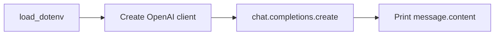
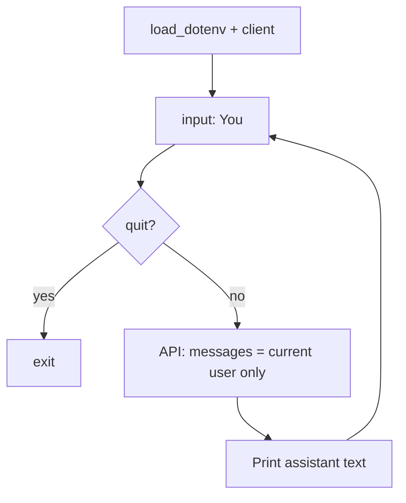

# Day 01 — First contact with the model

**Goal:** Call a chat model through the OpenAI-compatible API (Ollama) and run a simple interactive loop.

## Files

| File | Purpose |
|------|---------|
| `hello_ai.py` | Single request: asks “What is Artificial Intelligence?” and prints the reply |
| `ai_assistant.py` | REPL: read user input until you type `quit` |

## Configuration

Both scripts load `.env` from the project root and use:

- `BASE_URL` — API base (e.g. `http://localhost:11434/v1`)
- `API_KEY` — placeholder for local Ollama (e.g. `ollama`)
- `MODEL` — chat model name

## Flow: `hello_ai.py`



1. Load environment variables.
2. Create `OpenAI` client pointing at Ollama.
3. Send one `user` message in `messages`.
4. Print `response.choices[0].message.content`.

## Flow: `ai_assistant.py`



1. Prompt once with `You: `.
2. While input is not `quit`, send **only the latest** user message (no memory yet—that is Day 02).
3. Pass Ollama options via `extra_body`: `num_predict` and `temperature`.
4. Handle empty responses and `APIError`.

## Run

From the repository root:

```bash
python day01/hello_ai.py
python day01/ai_assistant.py
```

## Takeaways

- Chat API shape: `model`, `messages` with `role` / `content`.
- Local models often need `extra_body.options` for generation length and stability.
- Error handling keeps the script from crashing on API failures.
