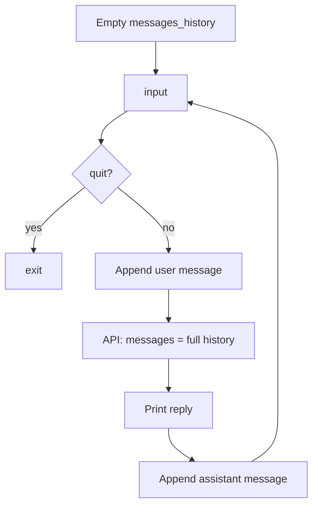
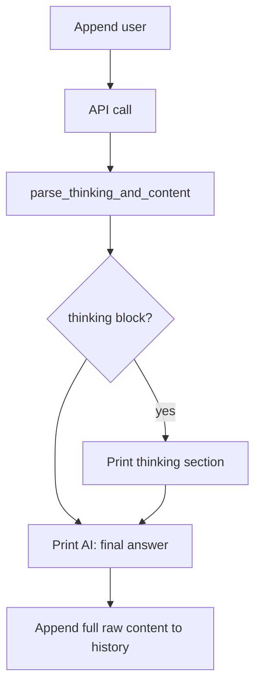

# Day 02 — Conversation memory (and reasoning display)

**Goal:** Keep full chat history so the model can refer to earlier turns. Optionally surface “thinking” from reasoning models.

## Files

| File | Purpose |
|------|---------|
| `ai_assistant.py` | REPL with `messages_history` (user + assistant turns) |
| `ai_assistant_with_thinking.py` | Same loop; splits thinking tags from the visible answer |

## Configuration

Uses `BASE_URL`, `API_KEY`, and `MODEL` from `.env`.

`ai_assistant_with_thinking.py` uses a longer timeout (180s) and higher `max_tokens` / `num_predict` (8192) for reasoning models.

## Flow: `ai_assistant.py`



1. Start with `messages_history = []`.
2. Each turn: append the user message, call the API with **entire** `messages_history`.
3. Print the assistant reply and append it to history with `role: assistant`.
4. Type `quit` to stop.

Unlike Day 01, the model sees prior questions and answers in one thread.

## Flow: `ai_assistant_with_thinking.py`



1. `parse_thinking_and_content()` uses regex to find `redacted_thinking` … `/redacted_thinking` blocks.
2. Thinking is printed for you; the user-facing line is the text **after** removing that block.
3. History stores the **full** assistant string (including thinking tags) so the model keeps consistent context on the next turn.

## Run

```bash
python day02/ai_assistant.py
python day02/ai_assistant_with_thinking.py
```

## Takeaways

- Multi-turn chat = grow `messages` list; order matters (`user` / `assistant` alternating).
- Reasoning models may embed hidden reasoning in tags; you can show it without sending a stripped version back in history.
- Day 03 will add a `system` message at the start of the same pattern.
