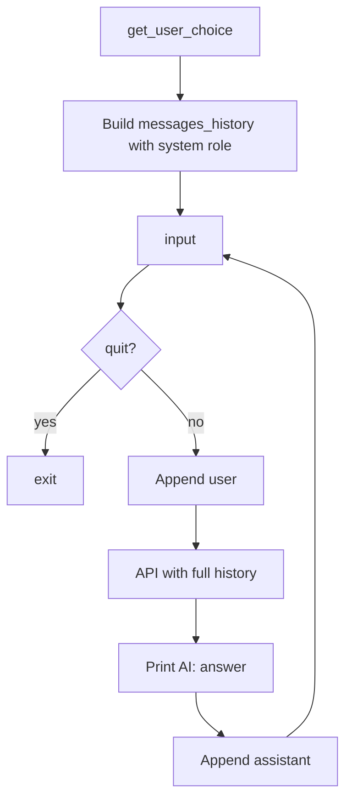

# Day 03 — System prompts and personalities

**Goal:** Steer model behavior with a `system` role message and let the user pick a persona at startup.

## Files

| File | Purpose |
|------|---------|
| `ai_assistant.py` | Memory + system prompt + personality menu |
| `util.py` | `roles` dict and `get_user_choice()` |

## Configuration

`BASE_URL`, `API_KEY`, `MODEL` from `.env`.

## Flow



1. **`get_user_choice()`** (`util.py`) prompts:
   - `1` — The Patient Tutor (teaching, quizzes, simple explanations)
   - `2` — The Daily Lifestyle Coach (habits, recipes; vegetarian-only, no egg)
   - Invalid input returns an empty system string.
2. **`messages_history`** starts as one message: `{ "role": "system", "content": choice }`.
3. Same loop as Day 02: append user → API → print → append assistant.
4. Exit with `quit` (case-insensitive).

## `util.py` detail

- `roles` maps integer keys to long system-prompt strings.
- Validation: choice must be digit `1` or `2`; otherwise `content` is `""` (model gets no persona text).

## Run

```bash
python day03/ai_assistant.py
```

## Takeaways

- **`system`** messages define behavior; they are usually first and not shown as “user” chat.
- Personas are just strings—you can add more entries to `roles` and extend the menu.
- Day 04 reuses `util.py` and adds tool functions beside the chat loop.
