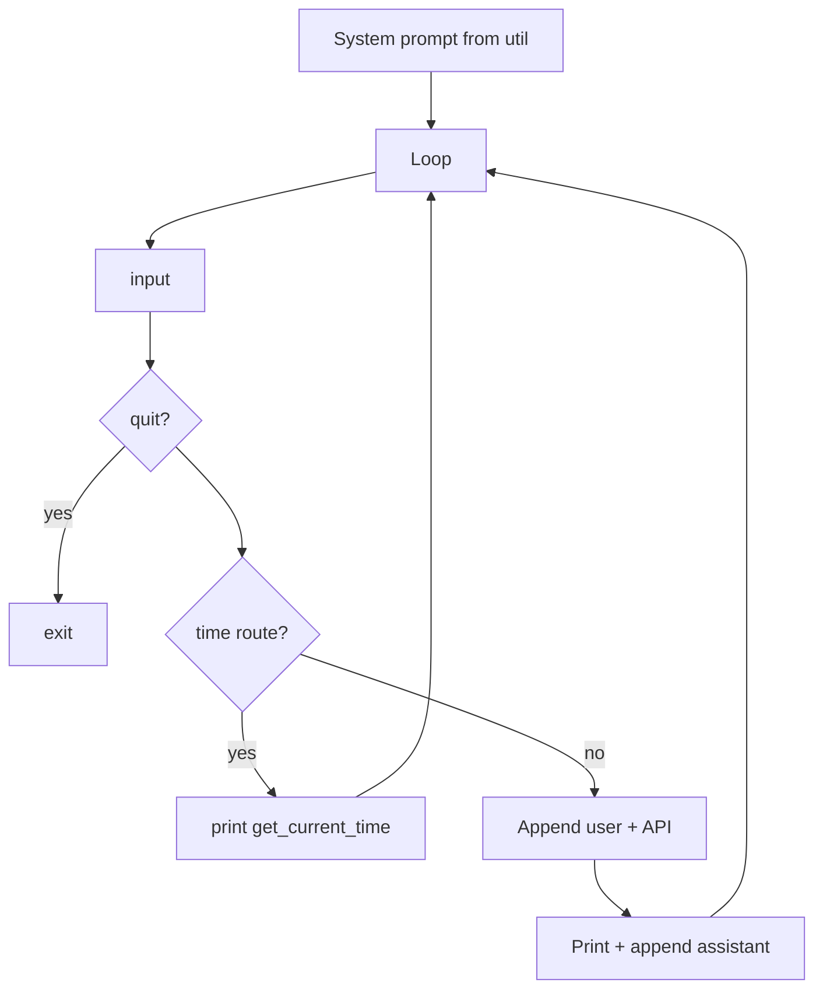

# Day 04 — Tools as Python functions

**Goal:** Introduce small, deterministic helpers (“tools”) and call them from the assistant loop before hitting the model.

## Files

| File | Purpose |
|------|---------|
| `tools.py` | `get_current_time()`, `roll_dice()`, `generate_password()` |
| `util.py` | Personality selection (same as Day 03) |
| `ai_assistant.py` | System prompt + memory + simple tool routing |
| `tools_manager.py` | Runs all three tools once (no chat) |

## Configuration

`BASE_URL`, `API_KEY`, `MODEL` from `.env`.

## Tool functions (`tools.py`)

| Function | Returns |
|----------|---------|
| `get_current_time()` | Current date/time string (`dd-mm-yyyy hh:mm:ss AM/PM`) |
| `roll_dice()` | Random integer 1–6 |
| `generate_password(length=14)` | Random password from letters, digits, punctuation |

These are ordinary Python functions—not OpenAI “function calling” yet. The assistant script decides when to invoke them.

## Flow: `ai_assistant.py`



1. Banner prints start time via `get_current_time()`.
2. Each iteration reads `You: `.
3. If input matches the time shortcut, print clock and **continue** (no API call).
4. Otherwise append user message, call chat API with history, update history.

**Note:** The condition `("time" or "clock") in user_input.lower()` always evaluates the substring `"time"` because `"time" or "clock"` is just `"time"`. It is a teaching shortcut, not full intent detection.

`roll_dice` and `generate_password` are imported but not wired in the REPL—try them via `tools_manager.py`.

## Flow: `tools_manager.py`

Linear script: print time, one dice roll, one generated password. Useful to verify tools without Ollama chat.

## Run

```bash
python day04/ai_assistant.py
python day04/tools_manager.py
```

## Takeaways

- Tools = reliable code; the model = language and reasoning.
- Routing can be keywords today; later days use file paths and retrieval.
- Day 05 adds `read_text_file()` and injects file content into the user message.
- Day 07 replaces keyword routing with an [LLM planner](../day07/README.md) that selects tools before answering.
