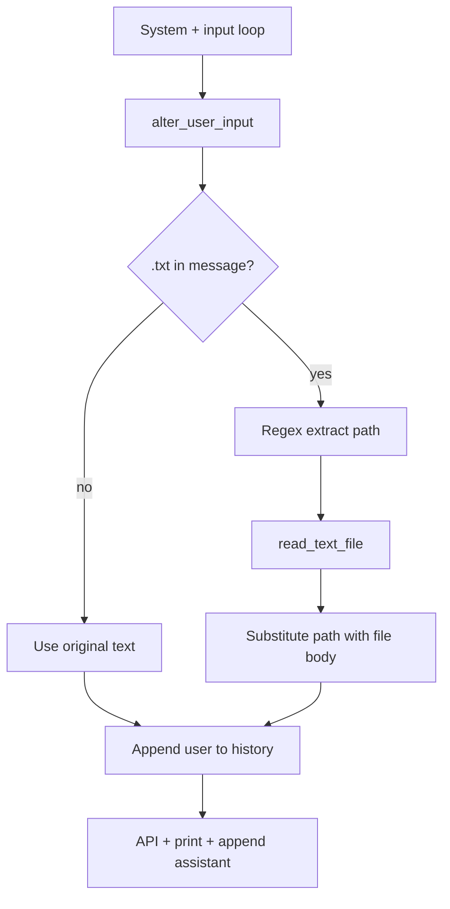

# Day 05 — Let the model “read” text files

**Goal:** When the user mentions a `.txt` path, load that file and replace the path in the prompt with the file contents so the model can answer about the text.

## Files

| File | Purpose |
|------|---------|
| `tools.py` | Day 04 tools plus `read_text_file(filename)` |
| `util.py` | Personality menu (Day 03) |
| `ai_assistant.py` | `alter_user_input()` + chat loop |
| `tools_manager.py` | Demo: read `day05/data/notes.txt` |
| `data/notes.txt`, `data/code.txt` | Sample files for experiments |

## Configuration

`BASE_URL`, `API_KEY`, `MODEL` from `.env`.

## `read_text_file`

- Opens the path with UTF-8 text mode.
- On `FileNotFoundError`, prints an error and returns `"quit"` (which can end the session on the next logic if propagated—here it becomes message content).

## Flow: `ai_assistant.py`



1. **`alter_user_input(user_input)`**
   - If `.txt` appears (case-insensitive), regex `[a-zA-Z0-9-_.\/\\]+\.txt` finds the first filename.
   - Reads file via `read_text_file`, then `re.sub` replaces that path with the full content.
2. Strips surrounding quotes from input before processing.
3. Enriched text is what gets stored in `messages_history` as the user turn.
4. Same chat API settings as earlier days (`max_tokens`, Ollama `extra_body`).

## Example usage

From repo root, after starting the assistant:

```text
You: Summarize day05/data/notes.txt
```

The model receives the note contents inline instead of only a path.

## Run

```bash
python day05/ai_assistant.py
python day05/tools_manager.py
```

## Limitations (intentional)

Discussed in code comments:

- One file per regex match pattern; multiple files need richer parsing.
- Large files blow up context and cost.
- No semantic search—only explicit paths.

Day 06 addresses scale and “find the right document” with a knowledge folder and retrieval.

## Takeaways

- Grounding the model = put facts in the `user` (or `system`) content.
- File tools are a bridge to RAG (chunk, embed, retrieve, then inject).
