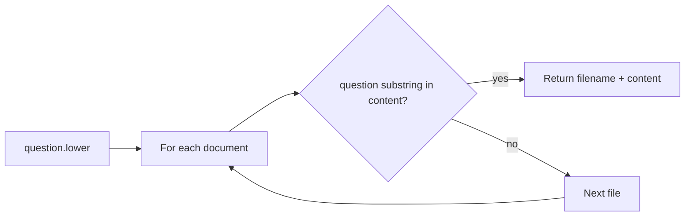
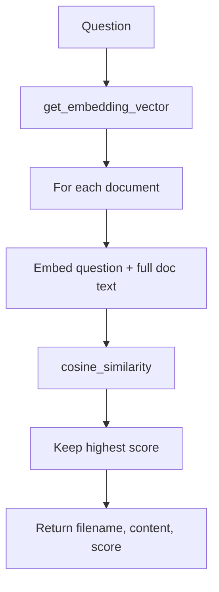

# Day 06 — RAG workflow (retrieval building blocks)

**Goal:** Build a small knowledge base, compare keyword vs embedding retrieval, and keep the Day 05 chat assistant (with `CHAT_MODEL`). Embeddings power semantic search over `knowledge/*.txt`.

## Files

| File | Purpose |
|------|---------|
| `knowledge/*.txt` | Company policy, product manual, customer support, technical FAQ |
| `similarity.py` | `cosine_similarity(vector1, vector2)` with NumPy |
| `test_embedding.py` | Ollama embeddings; `get_embedding_vector(question, content)` |
| `retriever.py` | Load docs; `retrieve()` and `retrieve_based_on_embedding()` |
| `test_retriever.py` | CLI demo of embedding retrieval |
| `tools.py`, `util.py`, `ai_assistant.py` | Same file-injection chat as Day 05 (`CHAT_MODEL`) |
| `data/` | Sample notes/code (like Day 05) |

## Configuration

From `.env`:

| Variable | Used by |
|----------|---------|
| `BASE_URL`, `API_KEY` | All API clients |
| `CHAT_MODEL` | `ai_assistant.py` |
| `EMBEDDING_MODEL` | `test_embedding.py` / retriever (e.g. `nomic-embed-text`) |

Run Ollama from repo root so `day06/knowledge` paths resolve.

## Knowledge base

`load_documents()` in `retriever.py`:

- Scans `day06/knowledge/*.txt`
- Returns `{ filename: full_text }`

Add or edit `.txt` files there to change what retrieval can find.

## Retrieval strategies

### 1. Keyword — `retrieve(question)`



- Exact substring match in document body (case-insensitive on content).
- Misses paraphrases (e.g. query “status code” vs doc saying “HTTP codes”).

### 2. Embedding — `retrieve_based_on_embedding(question)`



- `get_embedding_vector()` calls `client.embeddings.create` twice (`EMBEDDING_MODEL`).
- Picks the document with maximum cosine similarity (prints each score while looping).
- Returns dict: `filename`, `content`, `score`.

## `similarity.py`

Normalizes dot product: \(\frac{v_1 \cdot v_2}{\|v_1\| \|v_2\|}\).

## Chat assistant (`ai_assistant.py`)

Same flow as Day 05:

1. System persona from `get_user_choice()`
2. `alter_user_input()` for `.txt` paths
3. Chat completions with `CHAT_MODEL`

Retrieval modules are **separate demos**—wire `retrieve_based_on_embedding()` into the chat loop as a next step if you want full RAG in one app.

## Run

```bash
# Embedding smoke test (module-level calls at bottom of file)
python day06/test_embedding.py

# Example: semantic lookup (default query in file: "amazon")
python day06/test_retriever.py

# Interactive assistant
python day06/ai_assistant.py
```

To try keyword retrieval interactively, import `retrieve` in a short script or Python REPL from repo root.

## Suggested integration path

1. User asks a question (no `.txt` in message).
2. `retrieve_based_on_embedding(question)` → top document chunk or full file.
3. Prepend context to user message: “Use this context: … Question: …”
4. Call `CHAT_MODEL` as today.

## Takeaways

- **RAG** = retrieve relevant text, then generate an answer.
- Keyword search is simple; embeddings match meaning better.
- Production systems chunk documents, cache embeddings, and top-k retrieve—not whole-file embed every time (this repo keeps the logic easy to read).
