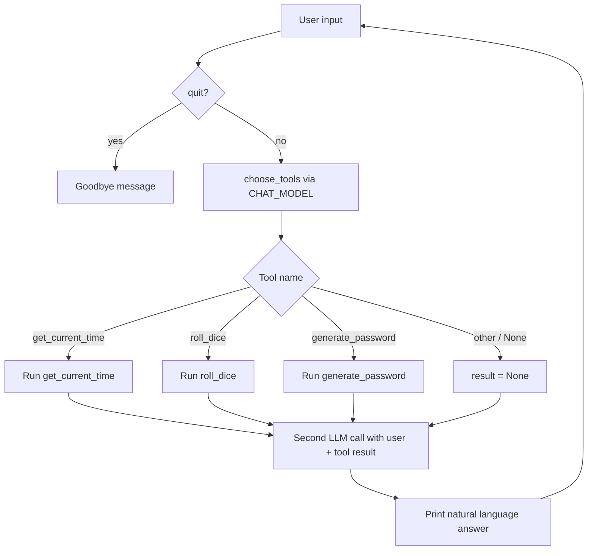

# Day 07 — AI planner and tool-calling agent (Python + Ollama)

**Learn how to build an agentic AI assistant that plans which tool to run before answering.** Day 07 replaces hard-coded keyword routing (Day 04) with a **two-step LLM workflow**: a planner model picks a tool, Python executes it, then a chat model replies in natural language.

Part of the [AI Agent Development](../README.md) course: build **local AI agents** with the OpenAI Python SDK, **tool use**, and [Ollama](https://ollama.com)—from simple chat to **multi-step LLM pipelines**.

## What you will build

| Capability | Description |
|------------|-------------|
| **Tool registry** | Reusable functions: time, dice, password (`tools.py`) |
| **LLM planner** | Model returns a tool name from the user request (`planner.py`) |
| **Agent loop** | Plan → execute → synthesize answer (`assistant.py`) |
| **Planner tests** | Quick checks for tool selection accuracy (`test_planner.py`) |

## Prerequisites

- Completed [Day 04](../day04/README.md) (tools) and basic chat setup from [Day 01](../day01/README.md)
- Ollama running with `CHAT_MODEL` pulled (same as [Day 06](../day06/README.md))
- `.env` at repo root with `BASE_URL`, `API_KEY`, `CHAT_MODEL`

## Files in this folder

| File | Purpose |
|------|---------|
| `tools.py` | `get_current_time()`, `roll_dice()`, `generate_password()`; `read_text_file()` (not wired in the agent yet) |
| `planner.py` | `choose_tools(user_request)` — LLM selects one tool name or none |
| `assistant.py` | Interactive **My AI Agent** REPL: planner + tools + final reply |
| `test_planner.py` | Prints planner output for sample prompts (e.g. time-related questions) |

## Architecture: plan → act → respond

This is a minimal **ReAct-style** pattern without explicit “reasoning” text: the planner step is the “think which tool,” Python is the “act,” the second model call is the “respond.”



### Step 1 — Planner (`planner.py`)

1. Build a prompt listing available tools and rules (“return ONLY the tool name”).
2. Call `chat.completions.create` with `CHAT_MODEL`.
3. Return raw `message.content` (expected values: `get_current_time`, `roll_dice`, `generate_password`, or empty/none for no tool).

### Step 2 — Executor (`assistant.py`)

1. Compare planner output with **exact** string matches (`if tool == "get_current_time":` …).
2. Run the matching Python function or set `result = None`.

### Step 3 — Synthesizer (`assistant.py`)

1. Send a single user message: original question + tool result + instructions (answer naturally, do not mention tools; if no tool result, answer from general knowledge when possible).
2. Print the assistant reply.

Each user turn uses **two** API calls (planner + answer), unlike Day 04’s single call with optional local shortcuts.

## How to run

From the **repository root** (so imports and `.env` work):

```bash
# Interactive agent
python day07/assistant.py

# Test planner only (edit prompts in the file)
python day07/test_planner.py
```

Type `quit` to exit the assistant.

### Example prompts

| User says | Expected planner tool | Tool output used in final answer |
|-----------|------------------------|----------------------------------|
| “What time is it?” | `get_current_time` | Current timestamp string |
| “Roll a dice” | `roll_dice` | Integer 1–6 |
| “Give me a safe password” | `generate_password` | 14-character random password |
| “What is Python?” | None / non-matching string | Model answers without tool data |

## Configuration

| Variable | Used by |
|----------|---------|
| `BASE_URL` | `planner.py`, `assistant.py` |
| `API_KEY` | Same |
| `CHAT_MODEL` | Planner and synthesizer |

## Limitations (and why they matter for production agents)

1. **Fragile tool matching** — The planner must return exact tool names. Extra words, quotes, or markdown break `elif tool == "..."`. Production agents use structured output (JSON schema) or native [function calling](https://platform.openai.com/docs/guides/function-calling).
2. **Planner accuracy** — `test_planner.py` notes wrong tools for edge cases (e.g. “yesterday’s time” may still pick `get_current_time`). More examples and stricter prompts—or a smaller dedicated model—improve routing.
3. **No conversation memory** — Each turn is stateless (unlike [Day 02](../day02/README.md)). History can be added to the synthesizer step next.
4. **Unused tools** — `read_text_file()` exists but is not in the planner list; combine with [Day 05](../day05/README.md) file injection or [Day 06](../day06/README.md) RAG in a later iteration.

## FAQ

**How is Day 07 different from Day 04?**  
Day 04 uses a fixed `if "time" in input` shortcut. Day 07 lets the **model** decide which tool fits the wording of the request.

**Is this the same as OpenAI function calling?**  
Same idea (model chooses an action, runtime runs code), but implemented manually with two chat calls instead of `tools=` on the API.

**What should I build next?**  
Add JSON tool plans, conversation memory, retrieval from Day 06 before the answer step, or register `read_text_file` in the planner prompt.

## Related lessons

- [Day 04 — Python tools](../day04/README.md)
- [Day 06 — RAG and embeddings](../day06/README.md)
- [Course overview](../README.md)

## Takeaways

- **Agentic workflows** separate *deciding* from *doing*: LLM for intent, Python for truth (time, randomness, secrets).
- **Two-call design** is easy to debug (log planner output before executing).
- **Exact string routing** is fine for learning; swap to structured tool calls before shipping.
