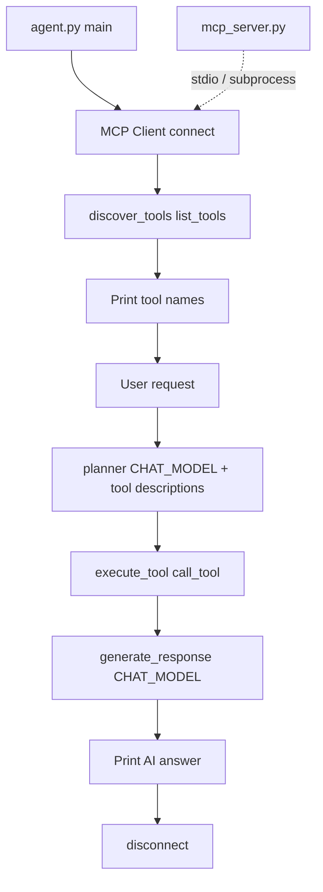

# Day 08 — Model Context Protocol (MCP) tools with FastMCP

**Learn how to expose agent tools through an MCP server and call them from a Python client.** Day 08 moves tools out of inline `tools.py` into a **Model Context Protocol** server, discovers them at runtime, and keeps the Day 07 **plan → execute → respond** pattern—now with **dynamic tool lists** from the server.

Part of the [AI Agent Development](../README.md) course: **local AI agents**, [Ollama](https://ollama.com), and standard **MCP** tooling via [FastMCP](https://github.com/jlowin/fastmcp).

## What you will build

| Capability | Description |
|------------|-------------|
| **MCP server** | Decorated tools: time, dice, password (`model_context_protocol/mcp_server.py`) |
| **MCP client** | Connect, `list_tools`, `call_tool` (`model_context_protocol/mcp_client.py`) |
| **Agent** | Discover tools → LLM planner → MCP execution → natural answer (`agent.py`) |
| **Client smoke test** | List tools and call one without the full agent (`model_context_protocol/test_client.py`) |

## Prerequisites

- [Day 07](../day07/README.md) (planner + synthesizer pattern)
- Python **3.12+** (see `pyproject.toml`)
- Ollama + `CHAT_MODEL` in `.env`
- Dependency: **`fastmcp`** (recommended: install from repo root with `uv sync` or `pip install fastmcp`)

## Project structure

```
day08/
├── agent.py                              # Full agent: MCP + planner + answer
└── model_context_protocol/
    ├── mcp_server.py                     # FastMCP server (@mcp.tool)
    ├── mcp_client.py                     # Async connect / discover / execute
    └── test_client.py                    # Minimal client demo
```

## MCP tools (server)

| MCP tool name | Description (from server) | Notes |
|---------------|----------------------------|--------|
| `current_time` | Current / latest time | Returns formatted datetime string |
| `roll_dice` | Six-sided die for board games | Integer 1–6 |
| `generate_password` | Strong password when user asks | `secrets.token_urlsafe(length)`; optional `length` (default 12) |

Tool **names differ from Day 07** (`get_current_time` → `current_time`). The planner must use names returned by `list_tools()`, not hard-coded Day 07 strings.

## Architecture



1. **Server** — `FastMCP` registers Python functions as MCP tools; `mcp.run()` when run as `__main__`.
2. **Client** — `Client("day08/model_context_protocol/mcp_server.py")` connects (path is relative to **repo root**).
3. **Agent** — Builds planner prompt from `tool.name` and `tool.description`, calls the chosen tool via MCP, then synthesizes a user-facing reply.

Day 07 runs tools in-process; Day 08 runs them **behind MCP**, so the same tools could be shared by Cursor, Claude Desktop, or other MCP hosts.

## Configuration

| Variable | Used by |
|----------|---------|
| `BASE_URL`, `API_KEY` | OpenAI client in `agent.py` (planner + answer) |
| `CHAT_MODEL` | Both LLM steps in `agent.py` |

Paths assume the current working directory is the **repository root** (same as `mcp_client.connect()`).

## How to run

Install dependencies from the repo root:

```bash
cd ai-agent-development
uv sync
# or: pip install fastmcp openai python-dotenv
```

### Option A — Full agent (recommended)

```bash
python day08/agent.py
```

Flow: lists discovered tools → `User:` prompt → planner picks a tool name → MCP runs it → prints `AI:` response → disconnects.

### Option B — MCP client only

```bash
cd day08/model_context_protocol
python test_client.py
```

Lists tools and invokes one tool (see script for which index it uses). Useful to verify server + client before running `agent.py`.

### Option C — Run server standalone (optional)

```bash
python day08/model_context_protocol/mcp_server.py
```

FastMCP can also be started by the client when given the server script path; a standalone run helps when debugging the server alone.

## Code flow: `agent.py`

| Step | Function | Detail |
|------|----------|--------|
| 1 | `asyncio.run(main())` | Entry point |
| 2 | `connect()` | MCP session to server script |
| 3 | `discover_tools(client)` | `await client.list_tools()` |
| 4 | `planner(user_request, tools)` | `build_tool_descriptions()` → single LLM call; returns stripped tool name |
| 5 | `execute_tool(client, tool_name)` | `call_tool` with `{}` args (password length not passed unless extended) |
| 6 | `generate_response(...)` | Second LLM call, natural language |
| 7 | `disconnect(client)` | Close MCP session |

OpenAI `client` is module-level; the MCP handle is a **local** variable inside `main()` only—planner/answer still use the global API client.

## Code flow: `mcp_client.py`

| Function | Role |
|----------|------|
| `connect()` | `Client(server_path)` + `__aenter__` |
| `disconnect(client)` | `__aexit__` |
| `discover_tools(client)` | Returns tool metadata from server |
| `execute_tool(client, tool_name, arguments=None)` | Returns `result.content[0].text` |

## Day 07 vs Day 08

| Topic | Day 07 | Day 08 |
|-------|--------|--------|
| Tool location | `day07/tools.py` | MCP server |
| Tool list | Fixed in planner prompt | Discovered via `list_tools()` |
| Execution | Direct Python calls | `call_tool` over MCP |
| Interop | App-only | Same tools usable by MCP-compatible IDEs and agents |

## Limitations and next steps

1. **Planner still returns free text** — Must match MCP tool name exactly; prefer JSON schema or native tool calling in production.
2. **`execute_tool` without arguments** — `generate_password(length=…)` is not wired from user text; extend `execute_tool` to pass parsed args.
3. **Single-turn agent** — No chat memory; add `messages_history` like [Day 02](../day02/README.md).
4. **Combine with RAG** — Retrieve context from [Day 06](../day06/README.md) before the answer step.

## FAQ

**What is MCP?**  
The [Model Context Protocol](https://modelcontextprotocol.io) standardizes how apps expose **tools, resources, and prompts** to AI clients.

**Why FastMCP?**  
It provides a small Python API (`@mcp.tool()`, `Client`, `FastMCP.run()`) so you can stand up a server without boilerplate.

**Why does my tool call fail?**  
Run from repo root, confirm `fastmcp` is installed, and ensure the planner output equals an MCP tool name (e.g. `current_time`, not `get_current_time`).

## Related lessons

- [Day 07 — In-process planner agent](../day07/README.md)
- [Day 04 — Original Python tools](../day04/README.md)
- [Course overview](../README.md)

## Takeaways

- **MCP decouples** tool implementation from the agent: server owns capabilities, client discovers and invokes them.
- **Dynamic tool descriptions** feed a better planner than a static list copied into code.
- **Async client** (`asyncio`) matches how MCP sessions are managed in real integrations.
