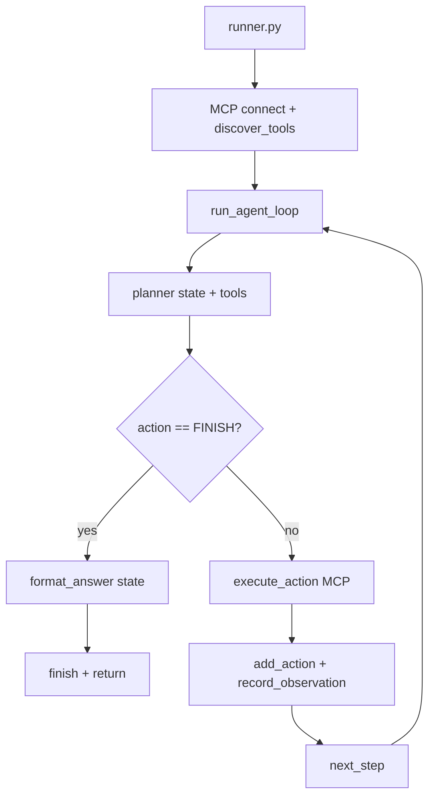

# Day 09 — Multi-step agent loop with state (MCP + planner)

**Learn how to run an agent that plans more than once:** observe tool results, track progress in **state**, and stop when the planner returns `FINISH`. Day 09 refactors [Day 08](../day08/README.md) into modules—**state**, **loop**, **planner**, **executor**, **runner**—so MCP tools can be chained across steps (for example password + time) without repeating the same action.

Part of the [AI Agent Development](../README.md) course: **local AI agents**, multi-step **ReAct-style** loops, [Ollama](https://ollama.com), and [FastMCP](https://github.com/jlowin/fastmcp).

## What you will build

| Capability | Description |
|------------|-------------|
| **Agent state** | Dict tracking request, steps, actions, observations, answer (`agent/state.py`) |
| **Agent loop** | `while can_continue` → plan → act → observe (`agent/loop.py`) |
| **Re-planning planner** | Next tool or `FINISH` from state + MCP tool list (`agent/planner.py`) |
| **Executor** | MCP `call_tool` behind a single `execute_action()` (`agent/executor.py`) |
| **Runner** | Connect MCP, run loop, print final answer (`agent/runner.py`) |
| **MCP layer** | Same three tools as Day 08 (`agent/model_context_protocol/`) |

## Prerequisites

- [Day 08](../day08/README.md) (MCP connect / discover / call)
- Python **3.12+**, `fastmcp`, `CHAT_MODEL` in `.env` at repo root
- Ollama running

## Project structure

```
day09/
└── agent/
    ├── runner.py                 # Entry point: MCP + run_agent_loop
    ├── loop.py                   # Multi-step loop orchestration
    ├── state.py                  # create_state, actions, observations, FINISH
    ├── planner.py                # LLM picks next tool or FINISH
    ├── executor.py               # execute_action → MCP
    ├── test_state.py             # Offline state demo (no LLM/MCP)
    └── model_context_protocol/
        ├── mcp_server.py
        ├── mcp_client.py
        └── test_client.py
```

## Day 08 vs Day 09

| Topic | Day 08 | Day 09 |
|-------|--------|--------|
| Steps per user request | **One** tool + one answer | **Up to `max_steps` (default 5)** |
| Planner input | User text only | User request + **actions** + **observations** |
| Stop condition | After first synthesis | Planner returns **`FINISH`** or step limit |
| Code layout | Single `agent.py` | **state / loop / planner / executor / runner** |
| Multi-tool requests | One planner pick | Planner can run several tools in sequence |

## Agent state (`state.py`)

```text
user_request, current_step, max_steps, actions[], observations[], finished, final_answer
```

| Function | Role |
|----------|------|
| `create_state(user_request, max_steps=5)` | Initial state |
| `add_action(state, action)` | Append tool name after execution |
| `record_observation(state, action, observation)` | Log step, action, MCP result text |
| `next_step(state)` | Increment `current_step` |
| `can_continue(state)` | Loop while not finished and `current_step < max_steps` |
| `finish(state, answer)` | Set `final_answer`, `finished=True` |

Run the offline demo:

```bash
python day09/agent/test_state.py
```

## Architecture



### Loop (`loop.py`)

1. `create_state(user_request)`
2. While `can_continue(state)`:
   - `action = planner(state, tools)`
   - If `action == "FINISH"`: `format_answer(state)` → `finish` → break
   - Else: `observation = await execute_action(action, state, client)`
   - `add_action`, `record_observation`, `next_step`
3. Return `state`

Note: `add_action` runs **after** execution (action is recorded once the tool has run).

### Planner (`planner.py`)

Each iteration the model sees:

- Original user request
- `Completed Actions` (no repeats allowed)
- `Previous Observations`
- MCP tool names and descriptions

Returns a single tool name or `FINISH` (stripped text; production should use structured output).

### Executor (`executor.py`)

Delegates to `execute_tool(client, action)`. Normalizes MCP results: prefer `result.content[0].text`, else `str(result)`.

### Final answer (`runner.format_answer`)

One LLM call with user request, all actions, and all observations—instructions to answer naturally and not mention planning, state, or tools.

## MCP tools

Same as Day 08: `current_time`, `roll_dice`, `generate_password` in `mcp_server.py`.

Client server path (from **repo root**):

`day09/agent/model_context_protocol/mcp_server.py`

## Configuration

| Variable | Used by |
|----------|---------|
| `BASE_URL`, `API_KEY`, `CHAT_MODEL` | `planner.py`, `runner.format_answer` |

Load `.env` from repo root (`load_dotenv()` in modules).

## How to run

From repository root (recommended for MCP paths):

```bash
uv sync   # if not already installed
python day09/agent/runner.py
```

`runner.py` adds `day09/agent` to the import path when launched this way, so `planner`, `loop`, and `executor` resolve correctly.

Example multi-step prompt:

```text
Generate a password and tell me the time when it was created.
```

Expected behavior: planner may call `generate_password`, then `current_time`, then `FINISH`; final answer synthesizes both observations.

### Other scripts

```bash
python day09/agent/test_state.py
```

`test_client.py` is a minimal MCP smoke test; it may use package-style imports—prefer `runner.py` for the full path unless you run it as a module from the repo root.

## FAQ

**How is this different from Day 02 memory?**  
Day 02 keeps **chat messages** for the model. Day 09 keeps an explicit **agent state** (actions + observations) for the **planner** each step—better for tool workflows than raw chat history alone.

**What if the planner repeats a tool?**  
Rules say not to; weak models may still repeat. Tighten prompts, lower temperature, or validate in code against `state["actions"]`.

**What happens at `max_steps`?**  
The loop exits without `FINISH`; `final_answer` may stay empty unless you add a fallback `format_answer` on timeout.

## Related lessons

- [Day 08 — Single-step MCP agent](../day08/README.md)
- [Day 07 — In-process planner](../day07/README.md)
- [Day 02 — Conversation memory](../day02/README.md)
- [Course overview](../README.md)

## Takeaways

- **Stateful agents** need a clear state object and a loop guard (`can_continue`).
- **Re-planning** after each observation enables multi-tool tasks without hard-coded scripts.
- **Separation of concerns**: loop orchestration vs planning vs MCP execution vs final narration.
- Next improvements: pass tool **arguments** from the planner, handle invalid tool names, and a fallback answer when steps exhaust without `FINISH`.
